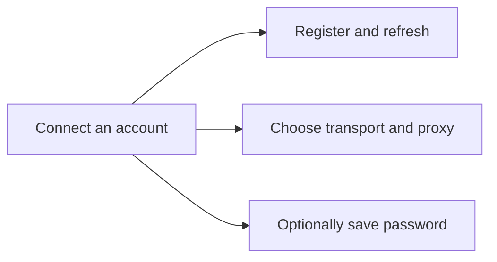
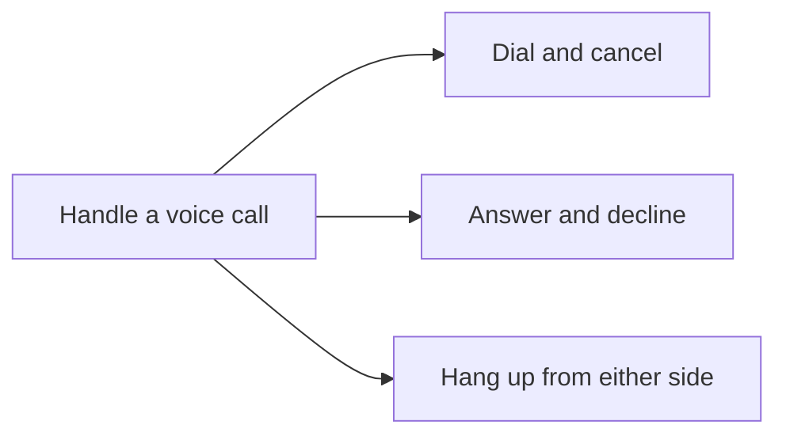
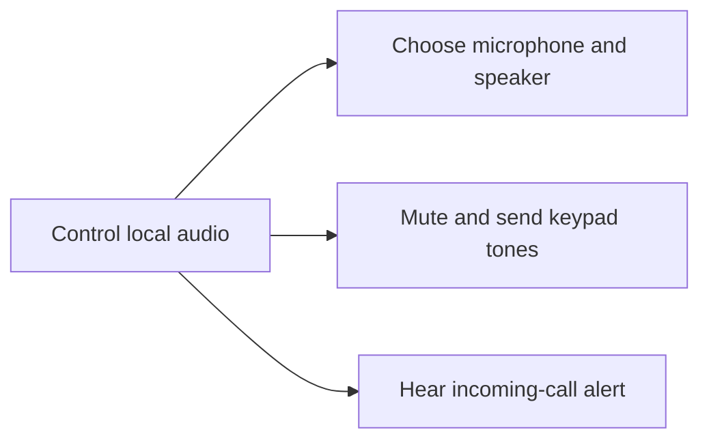
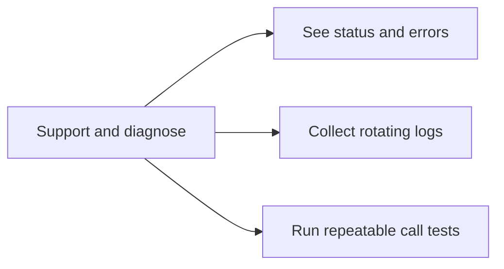

# 1. Business view

## Purpose and value

Softphone lets you make and receive voice calls from a Linux desktop using an existing SIP account. It combines account status, call controls, audio selection, and logs in one app. The PBX/provider supplies the account, routes calls, and connects to other networks.

The app and regression tests are ready for evaluation and further development. Deployment costs, provider charges, production reliability, adoption, and return on investment have not been measured.

## What users can do

### Connect an account

### Handle a call

### Control audio

### Find and report problems

## Stakeholders and responsibilities

These roles have no assigned owners. One person may fill several roles.

| Role | Interest | Responsibility |
| --- | --- | --- |
| End user | Calls and understandable controls | Supply account details, select devices, report reproducible problems |
| Product owner | Useful scope and readiness | Choose features and approve the intended provider and devices |
| Maintainer | Correct behavior and maintainability | Own source changes, tests, documentation, dependency patches |
| PBX/provider administrator | Reachable and authenticated calls | Provision accounts, certificates, dialplan, media relay, and routing |
| Desktop/operator support | Installation and diagnosis | Install prerequisites, handle keyring/device access, collect approved diagnostics |

## Common tasks

| Journey | Flow | Successful outcome |
| --- | --- | --- |
| Start calling | Open app → configure account → register → choose devices → dial | Registration succeeds and the peer answers with usable voice |
| Receive a call | Incoming alert → inspect caller → answer or decline | Correct call is handled and ringing stops |
| Use an automated menu | Connected call → press keypad digit | Negotiated DTMF reaches the remote menu |
| End and continue | Either party hangs up → app returns to idle → make another call | The remote call ends and local resources are released |
| Recover from failure | Read notice → disconnect if needed → correct settings/network → register again | Account becomes usable without restarting the entire workstation |

## Supported scope

The app supports one account and one active call. It does not support video, messaging, hold, transfer, conferencing, multiple accounts, or automatic redial. The provider handles account service, billing, emergency-service policy, and availability; this project does not implement or certify them.

## How to assess readiness

| Measure | Current evidence or proposed acceptance |
| --- | --- |
| Supported controls behave correctly | Local actor and wire regressions cover the implemented controls and failure cases |
| Hang-up responsiveness | Several loopback tests require completion in under one second; a live-provider result must be measured separately |
| Incoming-call awareness | Desktop attention plus generated ringtone; virtual output tested, physical audibility requires acceptance |
| Repeat-call reliability | Automated repeated-call and simultaneous-hang-up tests |
| Voice quality | Physical two-way listening, microphone mute, and intended-device testing are required before release |
| Supportability | Timestamped action, state, and SIP logs that rotate locally |
| Production quality targets | Availability, scale, latency distributions, and support response targets are not yet established |

Before release, test the intended PBX/provider, real microphone and speaker, and normal network. Use the [test matrix](../TESTING.md) alongside those checks.
