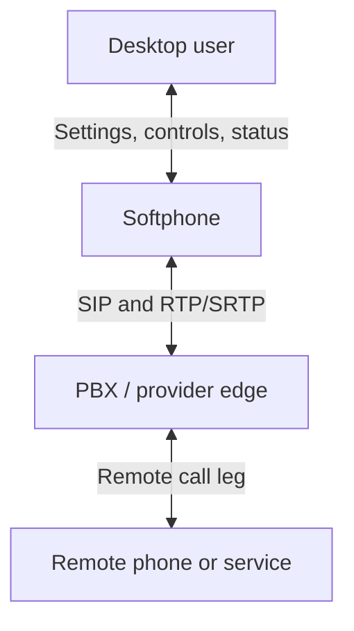
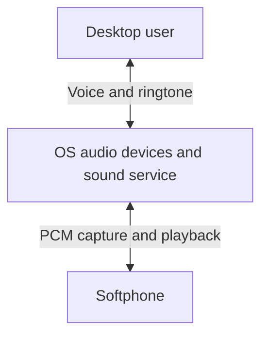
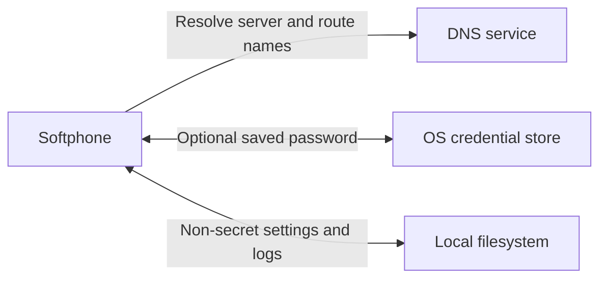

# 2. System / context view

## System boundary

Softphone runs as one desktop process containing the UI, call handling, SIP/media libraries, audio, ringtone, and logs. It uses external services for the provider, desktop sound, password storage, DNS, and files.

### Calls through the provider

### Local audio

### Supporting services

SDP and provider settings determine the voice route. The call diagram shows the provider relaying voice. Direct media and support for every NAT setup are not guaranteed. Asterisk examples use `direct_media=no`.

## External connections

| Interface | Direction | Contract / content |
| --- | --- | --- |
| Desktop UI | User ↔ app | Account form, status, dial pad, call controls, device selection, Escape shortcut |
| SIP registration | App ↔ registrar | Digest challenge/response, registration refresh, unregister |
| SIP dialog | App ↔ provider/peer | INVITE, progress/answer, ACK, CANCEL, BYE; responses and dialog identity |
| Voice | App ↔ negotiated media endpoint | Opus (default first choice) or G.711 PCMU/PCMA over RTP; required SDES-SRTP in secure mode |
| Keypad tones | App → remote media endpoint | Negotiated RFC 4733 telephone events during connected calls |
| Hostname lookup | App → DNS | Registrar route selection; SIP stack resolution of next-hop names |
| Audio hardware | App ↔ CPAL / OS audio | Capture, playback, device enumeration, incoming alert output |
| Credential storage | App ↔ keyring | Optional SIP password under the application service name |
| Settings file | App ↔ local filesystem | Account JSON containing configuration, excluding password |
| Diagnostic file | App → local filesystem | Filtered timestamped control, state, routing, and health records |

## What the app needs

- A reachable IPv4 SIP registrar/PBX/provider and valid account credentials are available.
- The provider supports the selected signaling/media profile and Opus or G.711 codecs.
- The desktop provides working audio devices and an OpenGL-capable window environment.
- Secure calling requires a trusted server certificate and compatible SDES-SRTP negotiation.
- Saving or retrieving passwords requires an available, unlocked OS credential store.
- The executable must remain running to receive calls. There is no background service independent of the desktop process.

## Provider routing

The registrar is the account service. An outbound proxy sends requests through a provider server, also called an edge. Twilio accounts use their SIP domain as the proxy automatically. Other accounts can set one explicitly.

A private Contact value identifies a SIP target but may not be reachable directly. The local RVoIP patch keeps Contact/request-URI values and routes through the provider. ACK reuses the original INVITE route or resolves the next-hop hostname. The app chooses a local address and port before building the endpoint, avoiding an identity with port zero. See the [architecture view](03-architecture-view.md).

## Security and limits

The app has no cloud service, public HTTP API, database server, message broker, or web frontend. Logs must exclude credentials, SDP security data, and raw SIP messages. They include socket addresses and internal call IDs, so review them before sharing.

Implementation sources: [account setup](../src/account.rs), [call coordination](../src/phone.rs), [audio](../src/audio.rs), [diagnostics](../src/diagnostics.rs).
