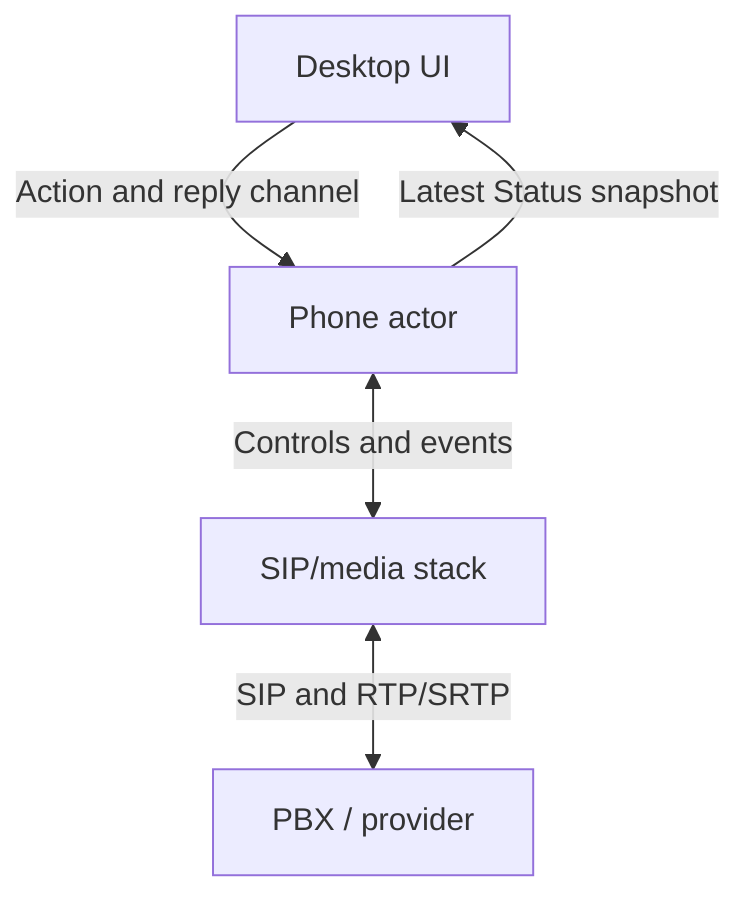
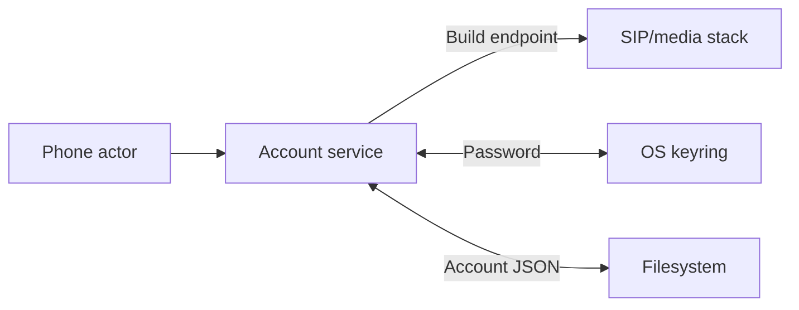
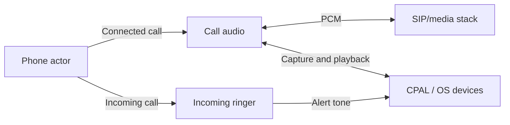
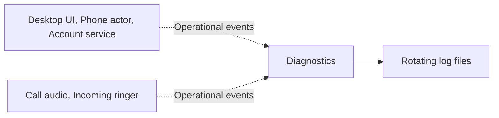

# 3. Architecture / logical view

## Component structure

### Call control

### Account setup

### Voice and ringtone

### Diagnostic logs

All components shown run in the same process. The SIP/media stack is a linked library.

## Responsibilities and ownership

| Component | Responsibilities | Owns |
| --- | --- | --- |
| Desktop UI | Render account/call state; submit actions; show errors; request attention | Editable form, checks for pending operations, displayed duration |
| Phone actor | Validate action against current call; coordinate registration, calls, deadlines, teardown | Endpoint control/events, current `Call`, status publication, end watchers, ringer |
| Account service | Normalize/validate settings, access credentials, choose network route, construct endpoint | Settings/keyring operations; no long-lived call state |
| Call audio | Resolve selected devices, bridge call PCM, expose microphone heartbeat | RVoIP running audio bridge and atomic health data |
| Incoming ringer | Generate a bounded-volume repeating alert without blocking SIP | Dedicated output thread, stop signal, speaker-release completion |
| SIP/media stack | Protocol transactions/dialogs, SDP, codecs, packet transport and media security | SIP transaction lifetime, media streams, negotiated routing |
| Diagnostics | Write filtered operational records with bounded rotation | Shared synchronized file writer |

## How components communicate

| Contract | Meaning |
| --- | --- |
| `Action` | Typed registration, disconnect, dial, answer, decline, hang-up, mute, DTMF, or audio-selection request |
| `PhoneHandle::perform` | Queue an action and wait for its result; sending it does not confirm remote completion |
| `mpsc` request queue | Holds up to 16 requests; changes call state one action at a time |
| `oneshot` reply | One result per submitted request or asynchronous completion |
| `watch<Status>` | Latest complete status; updates may skip intermediate snapshots |
| `Status` / `CallStatus` | Non-secret account, registration, current call identity/phase, audio choices, and notices |
| Endpoint events + lifecycle observer | Track call progress and ending; events for old call IDs cannot end a new call |
| Atomic mute flag | Local audio silence control without changing SIP hold state |

Most controls wait while another UI operation is pending. Hang up and Disconnect remain available, with a separate check to prevent duplicate requests.

## Design choices

| Decision | Reason | Tradeoff |
| --- | --- | --- |
| Native egui/eframe UI | Entire application is built with Cargo and Rust | Desktop dependency and rendering behavior need platform testing |
| One actor owns the call | Keep state changes and resource ownership clear | Awaited work can delay command/event handling; deadlines and background teardown limit this |
| One account / one call | Keep the UI and call states manageable | Call waiting, switching, and conference workflows are excluded |
| Background protocol teardown | Continue consuming events while BYE/CANCEL waits | Ending must remain a distinct state until confirmation or recovery |
| OS keyring + non-secret JSON | Keep password persistence out of account files | Keyring and filesystem cannot form one atomic transaction |
| Concrete local SIP port | Use the listening port in the endpoint identity | Small port-selection/bind handoff can fail on collision |
| Configured provider-edge routing | Reach private provider dialog targets through the correct proxy | Provider-specific interoperability still requires acceptance |
| Vendored RVoIP ACK correction | Preserve routes and correctly resolve hostname next hops | Local patch must be maintained across dependency upgrades |

The [patch note](../vendor/rvoip-sip-dialog/SOFTPHONE_PATCH.md) and [exact diff](../vendor/rvoip-sip-dialog/SOFTPHONE.patch) document the local changes. The patch keeps learned public routes and can place the configured edge before a learned private IPv4 hop. ACK reuses the INVITE's DNS-selected route when the next hop is unchanged; otherwise it resolves the new hostname. It must not silently fall back to private Contact.

## Failure cases and safeguards

| Scenario | Mechanism | Evidence and limits |
| --- | --- | --- |
| Old UI action arrives after another call starts | Call-ID validation and phase checks | Stale-control regression tests |
| Receiver hangs up an outgoing call | Endpoint terminal events plus lifecycle watcher | Local actor and synthetic-provider tests |
| Provider advertises a private target | Outbound proxy and patched ACK route/hostname handling | Numeric and hostname routing regressions; live provider validation remains separate |
| App closes during a call | Bounded graceful teardown before transport shutdown | Connected/ringing shutdown tests; network failure can still leave remote state until expiry |
| Audio device fails | Ongoing microphone heartbeat / ringer failure flag | Detects absent/stalled capture, not remote audibility or physical speaker output |
| Diagnostics accumulate | Rotation at 5 MiB, one prior file | Rotation/reopen tests; no external log collector is configured |

Source: [phone actor](../src/phone.rs), [UI](../src/ui.rs), [ringer](../src/ringer.rs), [dependency manifest](../Cargo.toml).
