# 4. Process / behavioral view

## Tasks and threads

### Commands and status

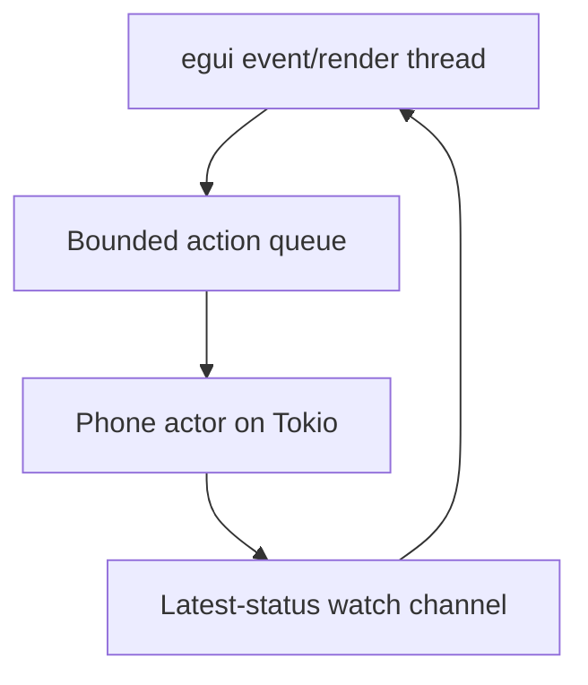

### SIP events and teardown

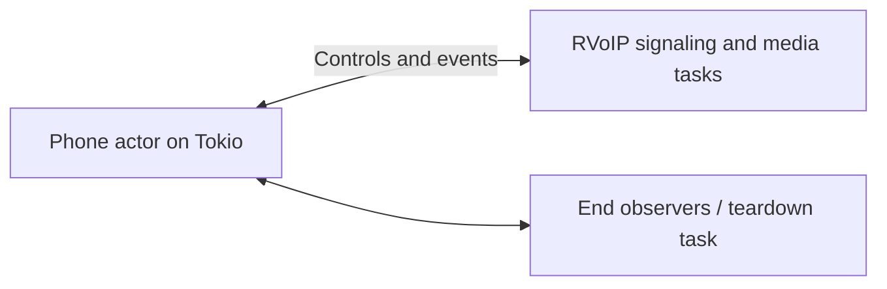

### Blocking work and audio

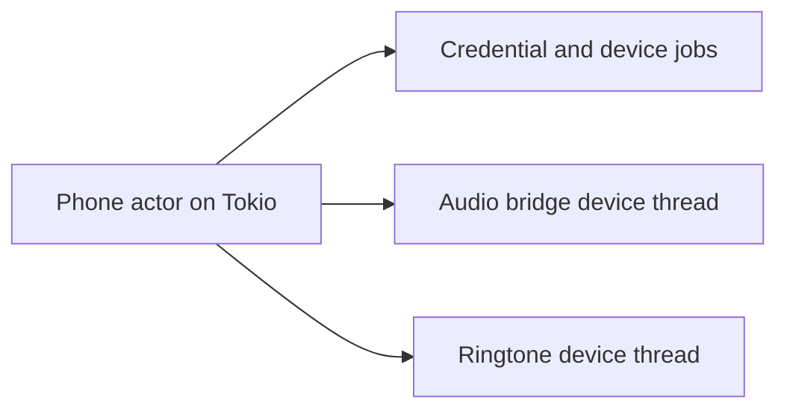

The app starts a Tokio runtime with several threads and an eframe window. The Phone actor handles requests, endpoint events, operation results, and a maintenance check every two seconds. It runs ordinary operations one at a time. Credential and device work runs in blocking jobs. Call teardown runs separately so the actor can keep handling events.

Status changes wake the UI even when hidden. The displayed call duration starts when the UI sees a connected call; it is not a billing record. CPAL streams run off the GUI thread. Ringing and call audio have separate device owners. When answering, the app waits briefly for the ringer to release the speaker.

## Registration states

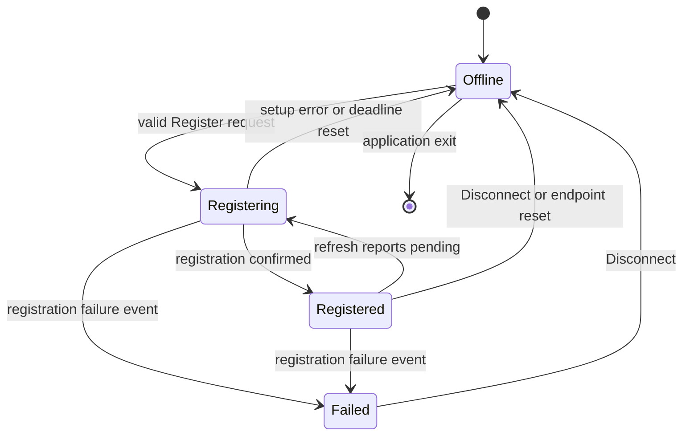

Invalid settings can stop registration before Registering. Startup, credential, or endpoint errors return the app to Offline with an error. If an open endpoint reports failure, the app may stay in Failed until the user disconnects. RVoIP refreshes registration; the actor tracks the result.

## Call state machine

### Outgoing call states

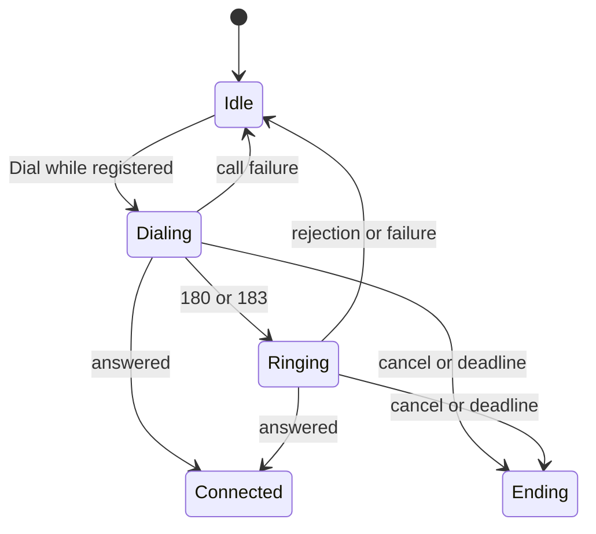

### Incoming call states

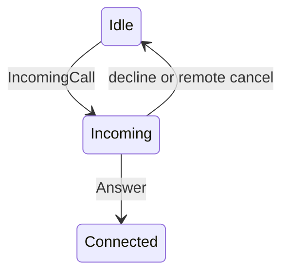

### Ending a call

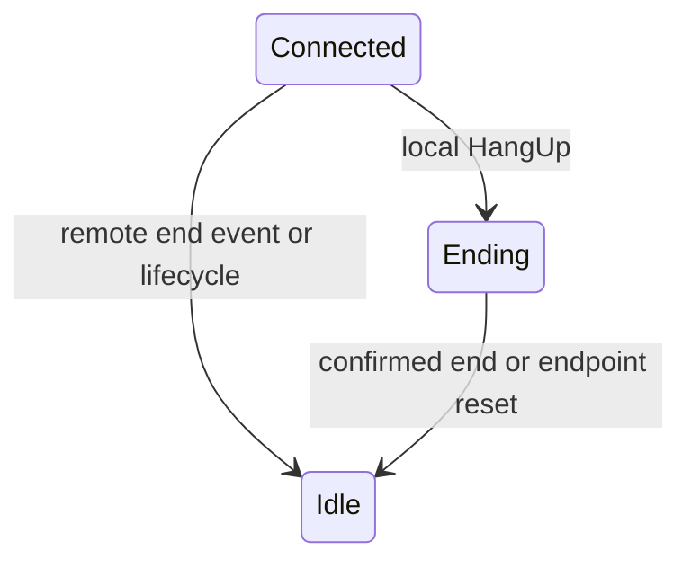

Idle means `call: None`; it is not a `CallPhase` variant. The call phases are Incoming, Dialing, Ringing, Connected, and Ending. Resetting the endpoint also sets registration to Offline. The app rejects a new incoming call as busy while it owns any call. Call controls must match the current call ID and phase.

## Outgoing call and receiver hang-up

### Set up the call

The Desktop UI sends Dial(target) to the Phone actor.

```mermaid
sequenceDiagram
    participant P as Phone actor
    participant S as SIP/media stack
    participant E as Provider edge
    participant R as Remote receiver
    P->>S: INVITE
    S->>E: INVITE
    opt Digest challenge
        E-->>S: 407
        S->>E: ACK and authenticated INVITE
    end
    E->>R: Route call
    R-->>E: Ringing / answer
    E-->>S: 180 then 200 with SDP and routing
    S->>E: ACK via selected edge
    S-->>P: CallAnswered
    P->>P: Start audio; watch call end
```

### Receiver hangs up

The actor publishes Connected status to the UI. Voice then flows over the negotiated media route until hang-up.

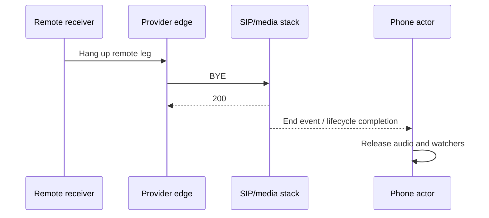

The actor publishes Idle status after call release. The diagrams show the protocol flow. The library controls the exact order of observed events and traces. A successful action reply does not confirm ACK delivery or that the remote call ended.

A provider edge can use a hostname while Contact contains an unreachable private address. ACK must reuse the original edge when the next hop is unchanged, or resolve the new route. Repeated INVITE 200 responses followed by about 32 seconds before release suggest checking ACK delivery. They do not prove the UI ignored BYE.

## Incoming call and ringtone

### Alert the user

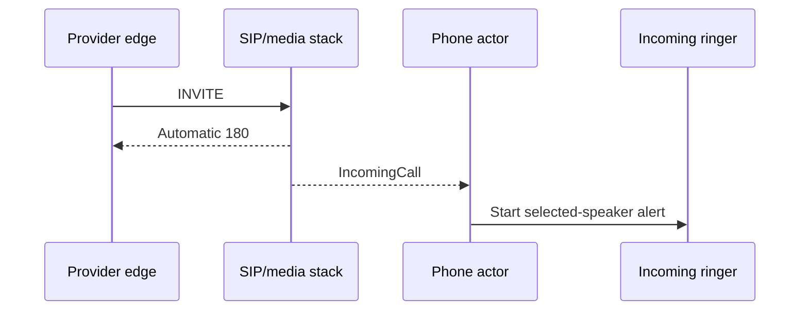

The actor also publishes Incoming status and requests desktop attention.

### Answer

The Desktop UI sends Answer(current call ID) to the actor.

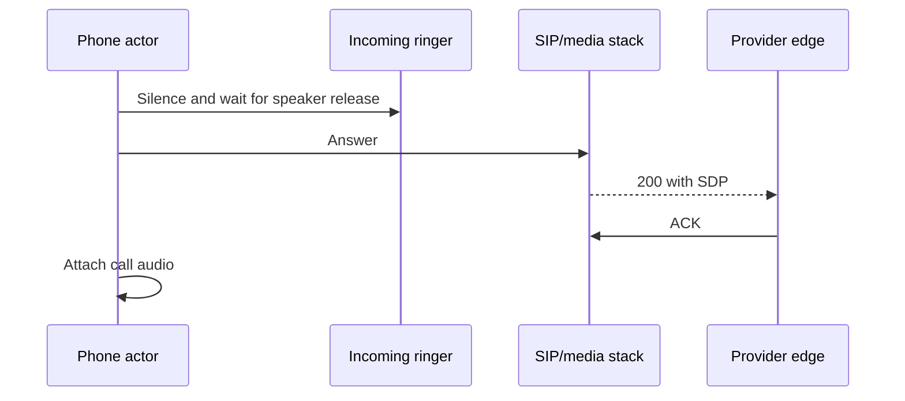

The actor then publishes Connected status to the UI.

### Decline

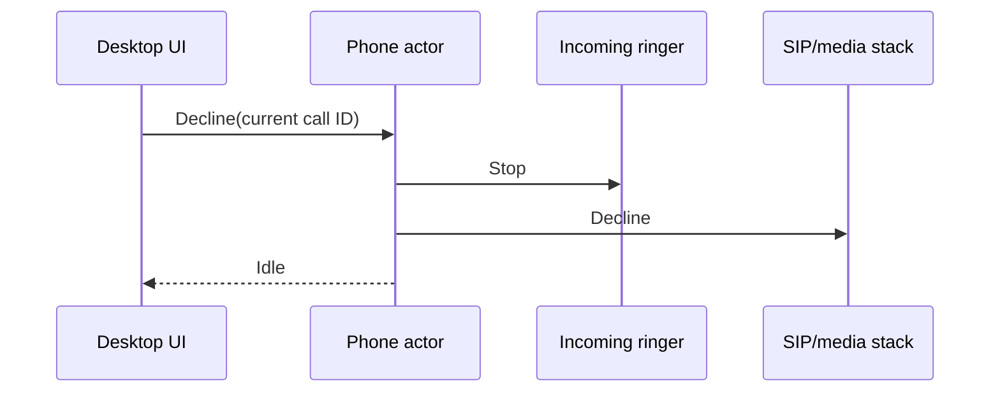

### Caller cancels

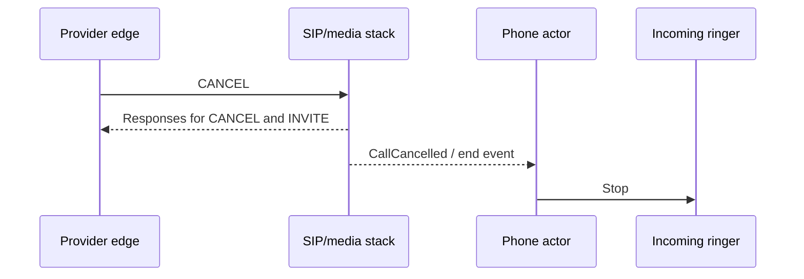

The actor publishes Idle status after cancellation.

The local ringtone combines 440 Hz and 480 Hz with a short fade: two seconds of sound, then four seconds of silence. It is separate from call audio. If output fails, the app shows a notice and still allows answering. Call tests skip device startup; the optional audio-device test uses a configured output.

## Local termination and shutdown

Local hang-up releases call audio, enters Ending, and runs `hangup_and_wait` in the background. The SIP stack sends BYE for a connected call or handles CANCEL and late answers for an unanswered call. An end event or completed teardown releases the call. `Disconnect now` can close the endpoint before teardown finishes.

On Disconnect or window close, the actor starts teardown or joins one already running. It waits up to two seconds, then unregisters and stops the endpoint with time limits. This gives background BYE a chance to run before transport closes. Network loss or forced closure can still leave the remote call or registration active until the provider expires it.

## Timing and failure controls

These time limits apply to individual operations. Scheduling and the two-second maintenance check can delay when a result is observed; they do not guarantee end-to-end response times.

| Operation | Configured value / behavior |
| --- | --- |
| Most SIP actions; DTMF; device-list validation | 5 seconds |
| Credential-store job | 10 seconds; blocking worker may finish after the wait expires |
| Endpoint startup | 10 seconds; account hostname lookup is separately bounded at 5 seconds |
| Registration pending watchdog | 30 seconds, checked by maintenance tick |
| Outgoing dial/ringing deadline | 45 seconds from outgoing-call creation |
| Background teardown | 33-second lifecycle observation with a 34-second outer timeout |
| Ending watchdog | 35 seconds, then endpoint reset |
| Registration-info polling | 1-second query bound |
| Disconnect grace / unregister / endpoint stop | 2 seconds / up to 3 seconds / up to 3 seconds |
| UI/process shutdown wait | 10 seconds; runtime shutdown additionally bounded at 1 second |
| Ringtone output release on answer | Up to 500 milliseconds |
| Microphone health | After five-second startup grace, last input heartbeat must be within four seconds |

If a failed dial or answer leaves the call state uncertain, the app disconnects before allowing another call. Network errors also disconnect and show a notice. The user must reconnect manually.

Source: [actor and deadlines](../src/phone.rs), [UI lifecycle](../src/ui.rs), [process entry/exit](../src/main.rs), [ringer](../src/ringer.rs).
