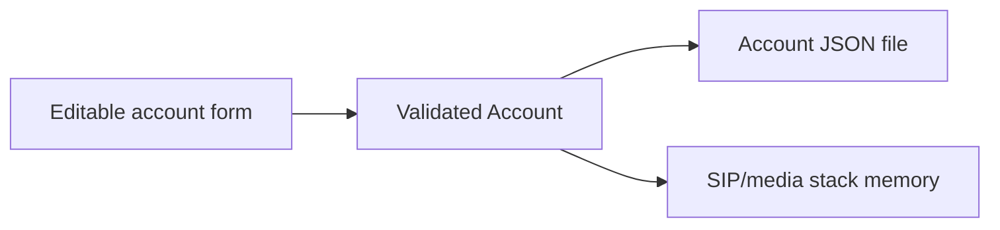
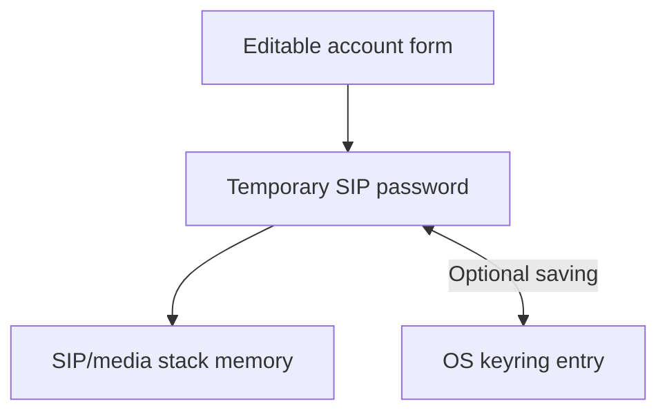
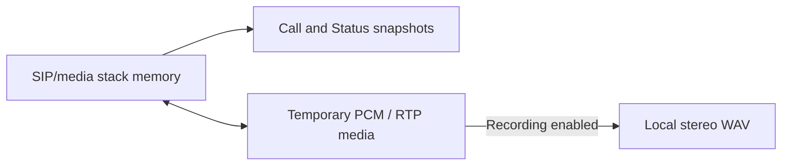
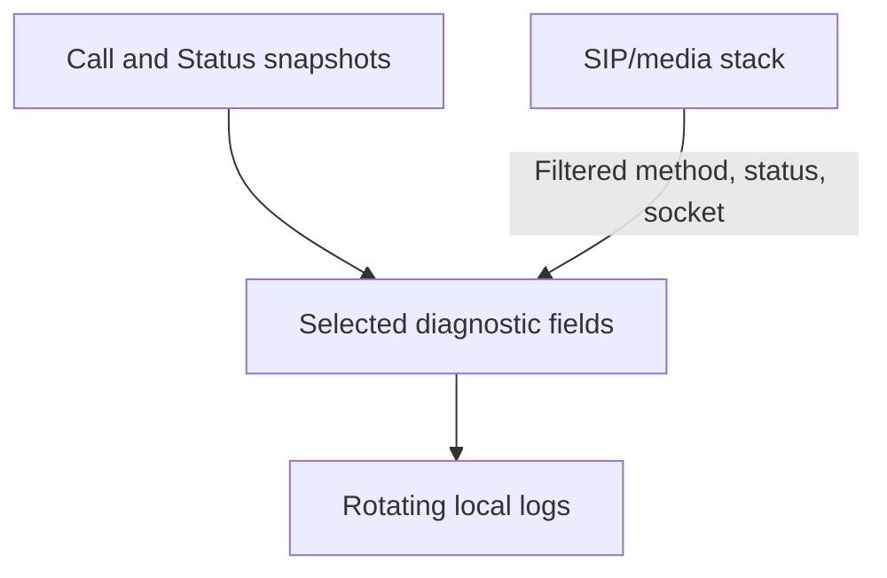

# 5. Data / information view

## Information flow and ownership

### Account settings



### Password



### Call state and voice



### Diagnostic records



The app saves account settings, contacts, and call history in local files. When recording is enabled, it saves the local and remote audio in separate channels of a WAV file. The provider keeps its own records under its own policies.

## Account file schema

The `Account` structure uses serde defaults and camelCase JSON keys. Missing fields use defaults. Invalid JSON shows a load error.

```json
{
  "registrar": "pbx.example.com:5060",
  "username": "1001",
  "authUsername": "",
  "outboundProxy": "",
  "secure": false,
  "rememberPassword": false
}
```

This example contains no working credentials.

| Field | Type / default | Meaning and validation |
| --- | --- | --- |
| `registrar` | String / empty | DNS hostname or IPv4, optional nonzero port; trimmed and lowercased |
| `username` | String / empty | SIP account name/extension; validated against the permitted ASCII character set |
| `authUsername` | String / empty | Optional distinct authentication name; trimmed, control characters rejected |
| `outboundProxy` | String / empty | Explicit host/IPv4 and optional port; empty enables automatic proxy selection for Twilio domains |
| `secure` | Boolean / false | UDP/RTP or TLS with required SDES-SRTP |
| `rememberPassword` | Boolean / false | Whether to use OS credential persistence |

On Linux, settings normally live at `$XDG_CONFIG_HOME/com.softphone.desktop/account.json` or `~/.config/com.softphone.desktop/account.json`. The app uses `dirs::config_dir()` to find the base directory, rather than the repository's `docs/` or `logs/` folders.

## Passwords and saving settings

Passwords are submitted separately from Account. An empty password field can use a saved password if the account identity and remember-password settings allow it. The keyring service is `com.softphone.desktop`, with an entry name based on `username:auth_username@registrar`. Changing only the proxy or transport uses the same entry.

Passwords cannot contain CR, LF, or NUL. The form clears the submitted password, but credentials remain in app/library memory while needed. Secure memory erasure is not guaranteed.

A mutex allows one settings save at a time within the process. The app writes JSON to a temporary file named with the process ID, attempts keyring changes, then renames the file over the account file. Normal cleanup removes an abandoned temporary file. A credential worker keeps the lock even after its wait times out, preventing overlap with the next save. Separate app processes do not share this lock. File and keyring changes are not one atomic operation; an interrupted or failed final save may require entering the password again.

## Data held in memory

| Object | Owner / lifetime | Important contents |
| --- | --- | --- |
| `Action` | Request until handled | Operation plus parameters; call controls include current call ID |
| `Status` | Actor; latest UI snapshot | Account, registration/error, optional call, audio choices, notice |
| `CallStatus` | Snapshot | Internal ID, sanitized peer label, phase, mute and recording flags |
| `Call` | Actor until terminal/reset | Incoming handle, outgoing/connected handle, or ending identity/deadline |
| Audio selection | In-memory status | Optional exact input/output device names; defaults use system devices |
| Mute / heartbeat | Connected audio owner | Atomic flag and elapsed-time heartbeat |
| Ringtone state | Incoming-call owner | Stop signal, active/failure flags, output-release completion |
| Display duration | UI memory | Elapsed time since observed connection; not provider billing duration |
| Media/security material | SIP/media stack memory | Negotiated addresses, PCM packets, SDP/SRTP parameters; excluded from application logs |

Audio selections apply to the current app session. The app refreshes device names and rejects unavailable selections. Caller labels come from SIP From, with URI passwords and routing details removed and length limited.

## Diagnostic data and retention

| Store | Content | Retention / sensitivity |
| --- | --- | --- |
| `logs/softphone.log` | Action receipt/completion, state changes, timings, registration, filtered SIP method/status/direction/sockets, health messages | Append across runs; rotate at 5 MiB |
| `logs/softphone.log.1` | Previous rotated file | One retained predecessor; later rotation replaces it |
| OS keyring | Optional SIP password | OS-controlled; app removes a previous credential when identity/persistence changes as applicable |
| Account JSON | Non-secret settings | Until replaced or removed by the user/operator |
| Call history | Recent call metadata and recording filenames | Latest 500 calls per SIP account |
| `recordings/` | WAV audio from connected calls while recording is enabled | Files remain on the device until removed |
| Media and call state | In-process objects | Released on call termination or disconnect |

Logs default to the project path saved at build time (`CARGO_MANIFEST_DIR`), regardless of the launch directory. Use `SOFTPHONE_LOG_DIR` to choose a writable location. Logs rotate by size, not age. Individual writes and errors mean rotation is not a strict 10 MiB total limit.

The app chooses its log fields and does not use a broad `RUST_LOG` override. Its file writer excludes passwords, authentication headers, full SIP messages, SDP, keypad digits, and caller addresses. Logs still identify socket addresses, internal call IDs, version, routing revision, and log path. Audio libraries may print separate messages to stderr, so terminal output can differ from the log file.

The app does not upload telemetry or delete logs on an age-based schedule. Review logs before sharing and follow local access and backup policies. Files use normal OS permissions/umask; the app does not encrypt the log store.

Source: [account schema/persistence](../src/account.rs), [runtime state](../src/phone.rs), [audio](../src/audio.rs), [diagnostics](../src/diagnostics.rs).
