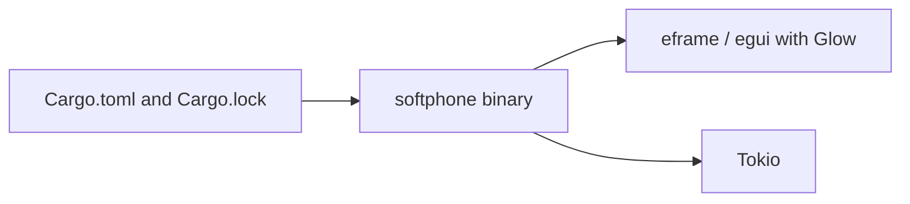
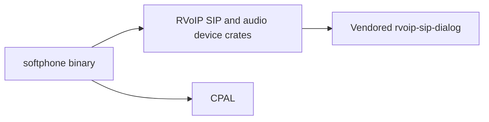
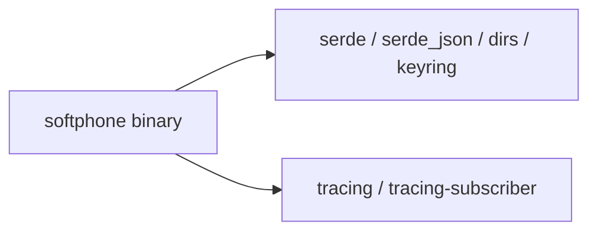

# 6. Implementation / development view

## Source layout

```text
Cargo.toml / Cargo.lock         Package, dependency pins, local dialog override
src/
  main.rs                      Native app/runtime startup and final shutdown
  ui.rs                        egui forms, controls, attention, duration
  phone.rs                     Actor, actions, states, events, deadlines
  account.rs                   Settings, keyring, endpoint/transport/proxy setup
  audio.rs                     Device selection, call bridge, microphone health
  ringer.rs                    Generated incoming ringtone and output ownership
  diagnostics.rs               Filtered console/file logging and rotation
  call_operations_tests.rs     Real actor + loopback SIP integration fixtures
  sip_routing_tests.rs         Synthetic provider wire regressions
vendor/rvoip-sip-dialog/        RVoIP dialog source with documented local patch
docs/                          Seven-view system documentation and SVG overview
README.md                      Quick start and user/developer entry point
TESTING.md                     Operation coverage and optional acceptance checks
RELIABILITY_REVIEW.md          Investigation history, fixes, evidence and limits
system_descrition_method.md    Supplied documentation framework
```

The package builds one native binary, `softphone`. Test modules compile under `cfg(test)`. Test actors can skip audio hardware startup while still using real SIP signaling and call handling.

## Dependencies

### UI and runtime



### SIP and audio



### Settings and logging



| Technology | Configuration / purpose |
| --- | --- |
| Rust | Edition 2024, minimum compiler 1.95 |
| eframe | Exact 0.37.0; default fonts, clipboard, Glow/OpenGL, X11 and Wayland |
| RVoIP crates | Exact 0.4.0 for SIP, SIP core, and audio-device bridge |
| Local patch | `[patch.crates-io]` selects `vendor/rvoip-sip-dialog` |
| CPAL | 0.15.3; enumeration, ringtone output, bridge integration |
| Tokio | Runtime, networking, synchronization, timing, background work |
| keyring | 4.2 with v1 API; platform credential-store integration |
| serde / serde_json / dirs | Account serialization and platform configuration path |
| tracing / tracing-subscriber | Application-owned operational diagnostics |

The lockfile fixes dependency versions for repeatable builds. Development builds disable debug information and incremental compilation, then strip debug information. Release builds strip symbols. Keep the local patch even when registry versions match: tests rely on its behavior.

## Build and contribution workflow

From the repository root, after installing the [native prerequisites](07-deployment-view.md):

```sh
cargo run --locked
cargo build --locked --release
cargo fmt --check
cargo test --locked
cargo clippy --locked --all-targets -- -D warnings
```

SIP tests need local UDP networking. External-PBX and audio-device tests are skipped by default and need the setup in [TESTING.md](../TESTING.md). The latest recorded default run had 35 passed and two optional tests ignored. This recorded result is not a live CI status.

The project has no GitHub Actions workflow, release packaging pipeline, or installer. Contributors must run the relevant checks and record results. The vendored dependency can emit warnings even when application Clippy checks pass.

## Guidelines for code changes

- Add UI controls through `Action` and the actor; do not let UI code own SIP dialog state.
- Carry a current call ID for call-specific operations and reject stale/invalid phases.
- Treat `Status` as a snapshot. Do not hold a watch borrow across an await or add secrets to it.
- Keep device opening, credentials, and blocking work away from the GUI thread. Remember that the actor waits for ordinary operations one at a time.
- Retain an Ending phase and bounded cleanup; sending a command does not confirm the remote call ended.
- Use filtered structured fields for diagnostics. Do not log passwords, full SIP, SDP, or keypad digits.
- Extend actor/wire tests for behavior changes and document any hardware/provider evidence separately.

These guidelines follow the current design. The [architecture view](03-architecture-view.md) lists component responsibilities; no teams are assigned.

## Dependency patch maintenance

The vendored source includes its upstream license and origin note. [SOFTPHONE.patch](../vendor/rvoip-sip-dialog/SOFTPHONE.patch) lists the changes; [SOFTPHONE_PATCH.md](../vendor/rvoip-sip-dialog/SOFTPHONE_PATCH.md) explains them.

The patch keeps ACK routes, handles private IPv4 routes through the configured edge, and selects hostname next hops in the transaction manager. Tests using only numeric addresses missed the hostname bug. Keep the `localhost` proxy and Record-Route tests when upgrading.

When upgrading, compare upstream behavior with the patch, update the manifest and lockfile, and run default tests plus intended-provider and media checks. Update the routing-revision marker and docs as needed. Remove the local override only after confirming equivalent behavior. Source or doc edits do not authorize a release or publication.

## Documentation maintenance

`docs/` describes the current system; the root reliability review keeps the investigation history. Update schemas in the data view, timing and sequences in the behavior view, dependencies here, and operating needs in the deployment view. Keep Mermaid diagrams and the SVG summaries consistent with code. Do not publish build output, logs, local account files, or credentials.
