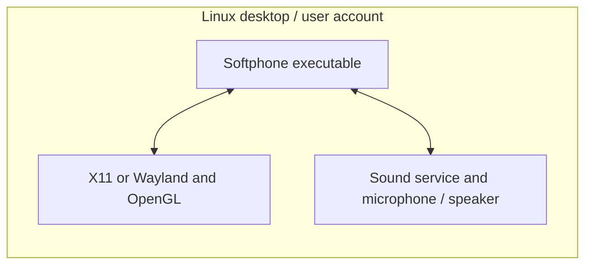
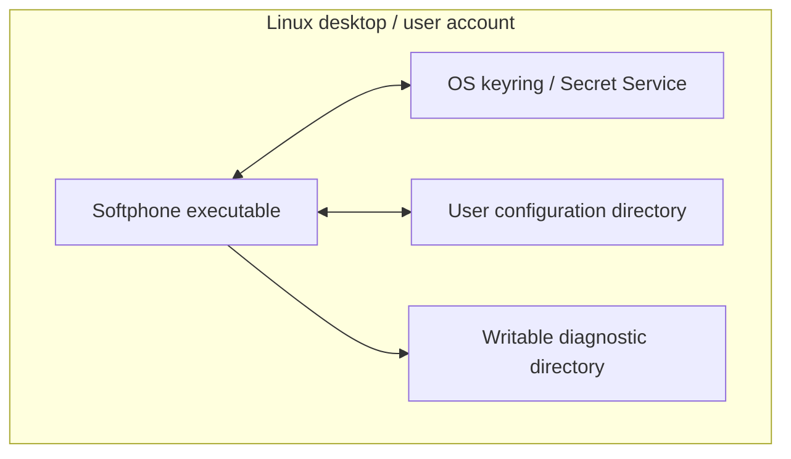
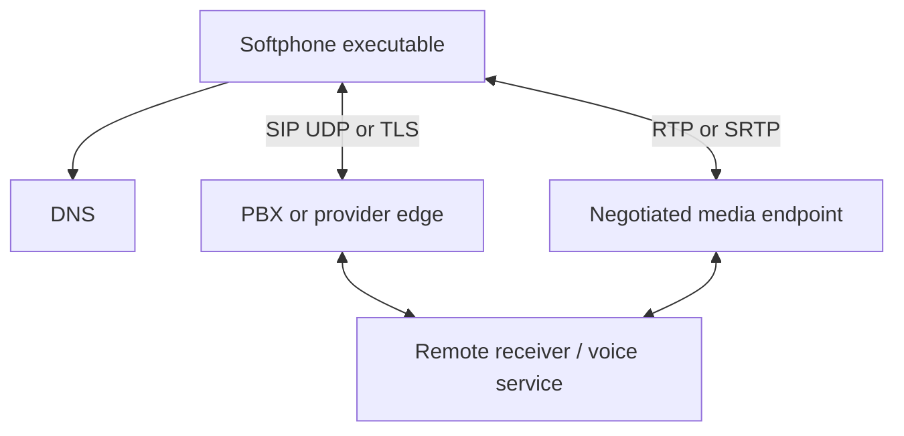

# 7. Deployment / physical / technology view

## Where the app runs

### Desktop display and audio



### Local storage



### Provider network



The network path may use a LAN, VPN, or the Internet.

The provider edge and media endpoint may run on the same infrastructure. They have separate roles in the network diagram. The app has no managed server, container cluster, shared database, or load balancer.

## Desktop prerequisites and installation

Linux is the tested development platform. Building requires Rust 1.95 or newer and native audio and windowing libraries. On Debian/Ubuntu, run:

```sh
sudo apt install build-essential pkg-config libasound2-dev libxkbcommon-dev libwayland-dev libx11-dev libxi-dev libgl1-mesa-dev
cargo build --locked --release
```

Run the resulting executable:

```sh
./target/release/softphone
```

The app needs a graphical session, OpenGL, audio, and OS libraries and services. Windows/macOS and installer packages have not been tested. Any launcher or package must provide the same settings, certificate trust, audio access, and writable log location.

For development, use `cargo run --locked`. Tests need local sockets. A sandbox error that blocks socket creation means the SIP checks could not run.

## Environment and configuration

| Setting / resource | Location / behavior |
| --- | --- |
| Account configuration | `dirs::config_dir()/com.softphone.desktop/account.json` |
| Linux default | `$XDG_CONFIG_HOME/com.softphone.desktop/account.json`, or `~/.config/com.softphone.desktop/account.json` |
| Password persistence | OS keyring service `com.softphone.desktop`, when enabled |
| Log directory | `SOFTPHONE_LOG_DIR` if set; otherwise `<build-time project directory>/logs` |
| Main / previous log | `softphone.log` and `softphone.log.1` |
| Routing revision | `ack-hostname-v3` in startup diagnostics |
| Audio selection | In-memory microphone/output choice; default devices when unset |
| Virtual ALSA tests | `ALSA_CONFIG_PATH` selects a deliberately configured test output; normal installations use the desktop audio configuration |

For a copied or installed binary, set a writable log directory explicitly rather than relying on the build machine's project path:

```sh
SOFTPHONE_LOG_DIR="$HOME/.local/state/softphone" ./target/release/softphone
```

Set SIP hostnames, transport, and proxy in the account form. Saving or retrieving remembered passwords requires an unlocked credential store.

## Network requirements

| Traffic | Requirement |
| --- | --- |
| Registrar/proxy SIP | Reach configured host/port; defaults UDP 5060 or TLS 5061 |
| Local SIP listener | Concrete OS-selected IPv4 address/port; inbound provider signaling must reach its established path |
| Voice media | Allow negotiated RTP/SRTP addresses and ports; media is not carried on the SIP signaling port |
| Hostnames | Working registrar DNS and SIP-stack route resolution |
| TLS | Valid certificate chain/trust and compatible secure profile |

The app uses the OS route to the registrar, including VPN routes, to choose a local interface. It selects a listening port before building its SIP identity. Another process could take the port before the SIP stack binds it; that collision causes startup to fail.

Use your provider's current network requirements; do not copy example IPs from logs into firewall or proxy settings. The app has no ICE/TURN settings and cannot guarantee every NAT setup. Start with a reachable PBX that relays voice. Asterisk examples use `direct_media=no`, G.711, and RFC 4733 DTMF. Twilio accounts route through their configured domain while keeping private Contact values intact.

## Test environments and limits

| Environment | Characteristics | What it proves |
| --- | --- | --- |
| Local automated tests | Loopback SIP endpoints, synthetic provider, hardware audio disabled in actor fixtures | State/control behavior, routing, deadlines, and lifecycle assertions |
| Virtual audio test | Explicit virtual ALSA output; generated PCM inspected | Ringtone stream startup, nonzero output, and stopping; no physical audibility claim |
| PBX integration test | Dedicated account and documented 600/601/602 dialplan | Repeat-call behavior, media plumbing, DTMF and configured transport against that PBX |
| Intended workstation/provider | Real credentials, devices, network, certificates | Required acceptance evidence before relying on the phone for regular use |

One app process owns the account and call. Extra instances do not provide high availability and may conflict with provider contact limits or settings/keyring updates. The app has no automatic scaling, standby failover, or saved live-call recovery.

## Startup, shutdown, and recovery

1. Start the executable and confirm the diagnostic path/revision.
2. Load or enter the account; register and confirm Registered state.
3. Select devices between calls, and complete inbound/outbound listening tests.
4. Verify both parties can hang up and that another call works.
5. On exit, allow the bounded graceful teardown/unregister sequence to finish.

Network errors or uncertain dial/answer failures can reset the endpoint. Fix the problem and register again. If registration failed while the endpoint stayed open, disconnect first. A crash or forced stop can leave the remote call or registration active. Restarting restores saved settings but cannot restore a call.

Back up non-secret settings if needed. Follow the OS keyring's recovery policy for saved passwords, or enter the SIP password again. The project has no disaster recovery procedure or guaranteed recovery time for active calls.

## Logs and troubleshooting

The app saves local logs and shows notices. It has no metrics exporter, central telemetry, or automatic alerts.

| Symptom / trace | Investigate |
| --- | --- |
| No Registered state | Account/auth name, password/keyring, DNS, host/port, transport, provider response |
| Repeated INVITE 200 responses | ACK routing/delivery; compare selected edge and actual ACK destination |
| Local Hang-up request followed by BYE retries | Next-hop route, reachability, response delivery, provider dialog state |
| Receiver hangs up but app stays connected | Confirm whether inbound BYE arrived, was acknowledged, and led to terminal state/lifecycle completion |
| ACK goes to private provider IP with a hostname proxy | Verify the executable reports `ack-hostname-v3`; inspect route-resolution behavior |
| Ringtone absent | Selected output, device/default format, sound service, ringer failure notice |
| Microphone health warning | Device availability and stream operation; also test speaker/remote audibility separately |
| `Operation not permitted` in socket tests | Local networking permission in the test environment |

After reproducing a problem, collect the main and previous logs. Note who hung up and roughly when. Log timestamps use UTC; convert local times before comparing them. Logs exclude passwords, full SIP, and SDP, but contain network addresses and internal IDs. Keep these limits when adding logging.

Sources: [entry point](../src/main.rs), [account/network setup](../src/account.rs), [diagnostics](../src/diagnostics.rs), [call lifecycle](../src/phone.rs), [test coverage](../TESTING.md).
