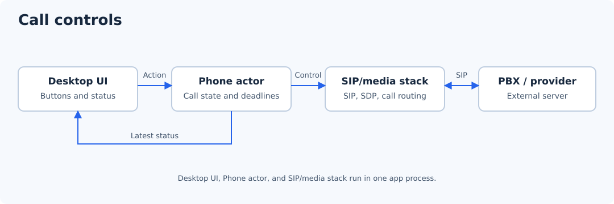
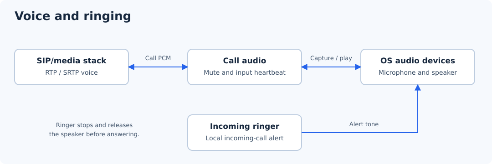
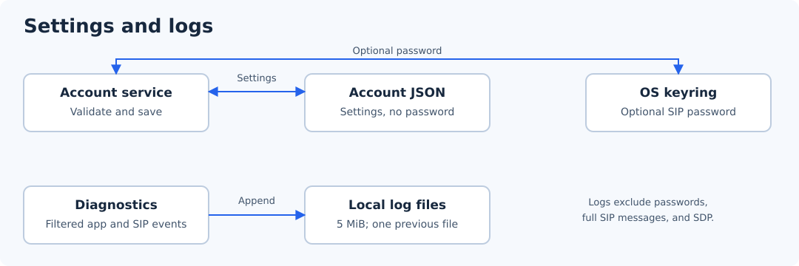

# Softphone system documentation

These seven views explain the Rust/egui voice-only SIP app using [the supplied description method](description-method.md). They cover one desktop process. The project does not define production service levels, assigned teams, or measured financial results.

### Call controls

### Voice and ringing

### Settings and logs

## Read by audience

| View | Main readers | Contents |
| --- | --- | --- |
| [1. Business](01-business-view.md) | Product owner, sponsor, end users | Purpose, capabilities, journeys, stakeholder responsibilities, success measures |
| [2. System and context](02-system-context-view.md) | All stakeholders | System boundary, actors, external interfaces, supported scope |
| [3. Architecture and logical structure](03-architecture-view.md) | Architects, maintainers | Components, internal contracts, decisions, quality scenarios |
| [4. Process and behavior](04-process-behavior-view.md) | Developers, integration engineers | Threads/tasks, state machines, registration, calling, teardown, deadlines |
| [5. Data and information](05-data-information-view.md) | Developers, security reviewers | Account schema, credentials, runtime data, retention and privacy |
| [6. Implementation and development](06-implementation-view.md) | Contributors | Source layout, dependencies, build, tests, patch maintenance |
| [7. Deployment and operations](07-deployment-view.md) | Operators, support, security reviewers | Desktop topology, prerequisites, networking, startup, diagnosis, recovery |

The [Windows distribution guide](windows-build.md) covers building, installing, and troubleshooting the Windows 10 / 11 installer and portable zip.

The separate [Android APK build guide](android-build.md) covers the mobile packaging toolchain (JDK, Android SDK/NDK, environment, and signing) used to rebuild the Android distribution.

## Baseline and evidence

These docs describe `softphone` **0.2.0**, Rust edition 2024, egui/eframe **0.37.0**, and RVoIP **0.4.0** with the local dialog patch. Development and testing target Linux. Startup logs identify the latest routing fix as `ack-hostname-v3`.

The latest recorded run had **35 default tests passed**. External PBX and audio-device tests run only when requested; the virtual ALSA ringtone test also passed. These results do not establish production reliability or compatibility with every provider. Physical audio, sustained secure media, and the intended provider still need testing. See [test coverage](../TESTING.md) and [reliability history](../RELIABILITY_REVIEW.md).

## Diagram conventions and maintenance

Each Mermaid diagram covers one part of the system and renders on GitHub. Arrow labels explain the flow. The three SVG summaries above cover controls, audio, and storage. All app components run in the same process.

Keep component names consistent: **Desktop UI**, **Phone actor**, **Account service**, **Call audio**, **Incoming ringer**, **SIP/media stack**, and **Diagnostics**. Update the affected views when interfaces, states, stored fields, routing, or deployment needs change. Each view links to its source code. The root reliability review keeps the investigation history.
